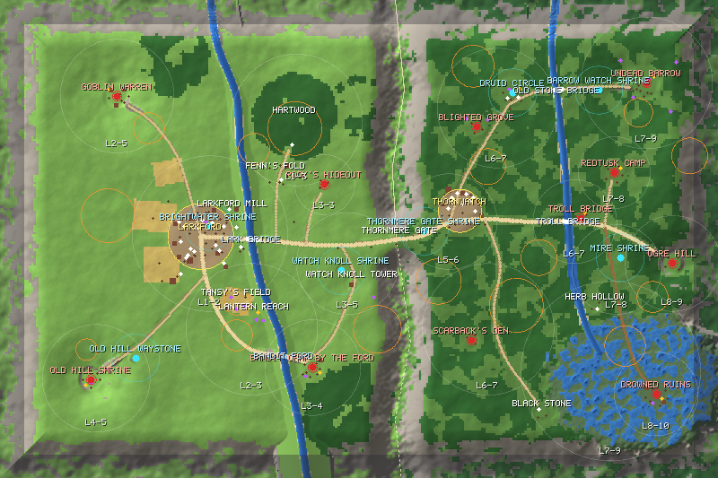

# Oathwild — the world (round 1)

The map, the places, the people, the story and the quests of Brightwater Vale and Thornmere Wilds, and the code that
serves them (`js/world/`). Built by the world helper on 2026-11-23. Owner rulings are in `PLAN.md` §0; anything marked
*Guessed* here is Claude's call and can be overruled.

Redraw the picture any time: `node prototypes/oathwild/tools/map-preview.mjs` (add `--text` for a list of every place
with its height, slope and level band; `--scale 1` for a 1 m-per-pixel version). North is at the top.

## The map

*Guessed size:* 1.2 × 0.8 km for both regions (x −600…600 east-west, z −400…400 north-south; z grows **south**, so
north is −z as in three.js). Mountains ring the edge; a 40 m border inside them is out of bounds.

- **Brightwater Vale** (west half, levels 1–5): open meadows, farm fields round the village of **Larkford**, the
  river **Brightwater** running north to south past the village, the Hartwood (wolves) to the north-east, the
  Gobbet Hills (goblins) in the north-west, the Old Hill (the Hollow Choir's shrine) in the south-west, and a ford
  in the south-east where bandits camp. A small hill in the east carries the Watch Knoll tower.
- **The Thornback Ridge** splits the two regions north to south. The only way through is **the Thornmere Gate**, a
  gap the Lark Road runs through.
- **Thornmere Wilds** (east half, levels 5–10): pine and oak forest, the ranger lodge of **Thornwatch** just past the
  gate, the **Druid Circle** in a northern clearing, the river **Mirewater** flowing south into **Thornmere Mire**
  (marsh, pools, a boardwalk), the **Troll Bridge** where the Lark Road crosses the Mirewater, the **Undead Barrow**
  on the downs in the north-east, **Ogre Hill** in the east and the **Drowned Ruins** out in the mire.

**Towns (2026-11-25).** Larkford is a market town on a hillside falling east to the Brightwater: a cobbled square
(fountain, three stalls) where the Lark Road, North Track, South Road and West Street meet; a ring lane ~40 m out (Bell
Lane, Well Lane, Fiddle Lane, Tower Lane); two alleys (shrine to Bell Lane, square to Fiddle Lane); Mill Lane down to the
river; the Lark Tower on a terrace at the top of West Street; the smithy, stable and training yard at the east way in.
Thornwatch is a frontier outpost of log cabins on Ranger Row and the Grove Trail. Houses, yards, lamps and villagers
come from `js/world/town.js` + `data/towns.json` (README "Towns").

Roads: the **Lark Road** (Larkford → Lark Bridge → Thornmere Gate → Thornwatch → Troll Bridge → Ogre Hill) is the
spine; trails branch to every place (North Track, Ford Road, Watch Lane, Old Hill Path, Fold Lane, Poacher's Path,
Grove Trail, Barrow Road, Bearwood Trail, the Mire Way boardwalk, Redtusk Trail). Every place is within 80 m of a road
and reachable on foot from the spawn. Four crossings: **Lark Bridge** (wood), **the Bandit Ford** (wade, 0.35 m
deep), **the Troll Bridge** and the **Old Stone Bridge** (stone).

### Level bands (monsters scale by place)

| Area | Levels | | Area | Levels |
|---|---|---|---|---|
| Larkford and around | 1–2 | | Thornmere Gate, Thornwatch | 5–6 |
| the Hartwood | 1–3 | | Greenhollow (Druid Circle, Blighted Grove) | 6–7 |
| southern vale (the Miller's Field, Lantern Reach) | 2–3 | | Troll Bridge, Bearwood | 6–7 |
| Gobbet Hills (goblin warren) | 2–5 | | Redtusk Camp, the Mire Way | 7–8 |
| Rook's Hideout | 3 | | Thornmere Mire, Barrow Downs | 7–9 |
| the Ford | 3–4 | | Ogre Hill | 8–9 |
| east vale (Watch Knoll) | 3–5 | | Drowned Ruins | 8–10 |
| the Old Hill | 4–5 | | | |

Outside a listed area a monster uses its region's band (vale 1–5, wilds 5–10).

## Places and people

**Shrines** (respawn, fast travel between the shrines your world has found, paid respec): Brightwater Shrine
(Larkford), Old Hill Waystone, Watch Knoll Shrine, Thornmere Gate Shrine, Druid Circle, Mire Shrine, Barrow Watch
Shrine. No camp or roaming pack is within 40 m of any shrine or the spawn.

**Camps** (cleared camps refill after 20–30 minutes): Goblin Warren (2–5, Goblin Warchief), Bandit Camp by the Ford
(3–4, Bandit Chief), Rook's Hideout (3, Rook Varrow), the Old Hill Shrine (4–5, Hollow Choir Speaker — the vale's
main boss), the Blighted Grove (6–7), Troll Bridge (6–7, Bridge Troll), Scarback's Den (7, Old Scarback), Redtusk
Camp (7–8, Redtusk), Ogre Hill (8–9, Hill Ogre), the Undead Barrow (7–9, the Barrow King — the wilds' main boss),
Drowned Ruins (8–10, Marsh Hag).

**Wildlife and roamers** (17 zones): wolves in the Hartwood, boars by the fold and in the west meadows, walking
scarecrows in the Miller's Field, thugs on the Ford Road, goblin scouts, Thornmere wolves at the gate, mountain lions on the
Greenhollow Heights, bears and lions in the Bearwood, orc raiders on the road, the restless dead on the Barrow Downs,
earth elementals on the east downs, drowned things in the mire.

Only the people of the main story have personal names (Elder Maren Holloway, Brother Tobin, Captain Edda Brandt,
Ranger-Captain Fen Asher, Archdruid Teodor; owner 2026-11-25). Everyone else is called by their job, and sentences
say "the Blacksmith" (`role: true` in data/npcs.json; tests/world/npc-names.test.mjs checks it).

**Larkford:** Elder Maren Holloway, Brother Tobin (shrine keeper, Cleric trainer, respec), Captain Edda Brandt
(watch, bounties), the Weapons Master (Warrior, Bladesworn), the Hunter (Ranger, Spellfletcher), the Locksmith
(Rogue, Shadowdancer), the Tower Mage (Mage, Spellblade, Pyromancer), the Hedge Druid (Druid), the Minstrel (Bard),
the Spirit-Talker (Shaman), the Fencing Master (Duelist), the Blacksmith (weapons, armour, repairs), the Shopkeeper
(goods), the Innkeeper (the Fiddler's Rest), the Stable Master (the horse), the Miller, the Weaver, the Farmer, the
Fisher; the Shepherd at her fold; the Farmer's Boy at the Hartwood's edge.

**Thornwatch:** Ranger-Captain Fen Asher, the Quartermaster (goods, repairs), the Paladin, the Scholar (Necromancer,
after the barrow tome), the Hooded Stranger (Gravecutter, after the contract), the Wild Fighter (Wrathborn), the
Witch Hunter, the Wayfarer, the Stormcaller.
**Druid Circle:** Archdruid Teodor; **the Grove Warden** (teaches Druids to call the wolf and the bear — she comes only
after the Grove Trial). **The Black Stone:** the Voice in the Stone (Warlock pact and trainer).
**Herb Hollow:** the Herbalist (moves to the Mire Shrine once you lead her out).

Every round-1 class has a trainer (a test checks it).

## The story (main thread)

Long ago the first oath to guard the vale was sworn by a king, and broken by him; the druids bound him under the
Thornmere. Now a cult, **the Hollow Choir**, is putting out the old shrine flames to wake him.

| # | Quest | Level | Giver → hand-in | What happens | Reward |
|---|---|---|---|---|---|
| 1 | The Silent Bell | 1 | Elder Maren → Brother Tobin | The shrine bell cracked by itself; ash in the crack means the Old Hill flame went out. | 75 XP, 8 gold |
| 2 | Tracks by the River | 2 | Tobin → Captain Edda | Search Lantern Reach, find a Hollow Choir token. | 105 XP, 12 gold |
| 3 | The Ford Road | 4 | Edda → Edda | Defeat the Bandit Chief who sells to the Choir; take his ledger. | 165 XP, 20 gold, a fine sword / staff / bow |
| 4 | The Hollow Choir | 5 | Edda → Maren | Climb the Old Hill, defeat the **Hollow Choir Speaker** (vale boss), relight the shrine. | 195 XP, 30 gold, fine body armour (3 kinds) |
| 5 | Through the Thornmere Gate | 5 | Maren → Fen Asher | Carry the warning east to Thornwatch. | 195 XP, 15 gold |
| 6 | Words of the Grove | 6 | Fen → Archdruid Teodor | Learn how the King was bound; take the heartwood tablet. | 225 XP, 20 gold |
| 7 | The Seal-Stones | 8 | Teodor → Teodor | Thin the barrow's dead, light three seal-stones (this weakens the King). | 285 XP, 30 gold, a fine ring / necklace |
| 8 | The Barrow King | 9 | Teodor → Fen | Defeat **the Barrow King** (wilds boss), take his crown. Under its rim: "Frostreach" — four oaths, sworn in four places; the others lie north. **Hook to the next regions.** | 315 XP, 50 gold, a rare weapon or shield |

## Side quests

| Quest | Region | Level | Giver | Kind | What happens | Reward |
|---|---|---|---|---|---|---|
| Wolves at the Fold | Vale | 1 | Shepherd | bounty | Hunt 6 Vale Wolves at the Hartwood's edge. | 52 XP, 6 gold, boots |
| A Boy in the Hartwood | Vale | 1 | Farmer | escort | Walk the farmer's boy home from the wolf woods (he follows your footsteps over the bridge). | 52 XP, 5 gold |
| The Miller's Sacks | Vale | 2 | Miller | fetch with a twist | The stolen flour turns up in the Miller's Field; the weaver asked for it. Keep one for her or return all. | 74 XP; her knitted charm + 6 gold, or 18 gold |
| The Runaway Mare | Vale | 2 | Stable Master | use | Calm Chestnut by Watch Knoll. | 74 XP, 10 gold, **horses cost 25% less** |
| Wanted: Rook Varrow | Vale | 3 | Captain Edda | bounty | Stop the poacher at his hideout. | 96 XP, 25 gold |
| Lights on the Water | Vale | 3 | Fisher | mystery | A second light on the river: the innkeeper smuggles cider. Report him or keep his secret. | 96 XP; 28 gold, or a signet ring + 8 gold |
| Goblin Trouble | Vale | 4 | Captain Edda | clear a camp | Clear the Goblin Warren and its warchief. | 118 XP, 22 gold, a buckler |
| The Grove Trial | Wilds | 6 | Archdruid Teodor | druid trial | Clear the Blighted Grove, wake two spirit pools. **Brings the Grove Warden (Druid companions).** | 162 XP, 18 gold |
| The Toll Bridge | Wilds | 7 | Fen Asher | boss | Move the Bridge Troll. | 184 XP, 30 gold, a helm |
| Bounty: Old Scarback | Wilds | 7 | Witch Hunter | bounty | Hunt the great scarred bear. | 184 XP, 28 gold, a bearskin jerkin |
| A Voice in the Mire | Wilds | 7 | Witch Hunter | pact | The Voice in the Stone offers a pact. Sealing it is **per player** and **opens the Warlock** for that player. | 184 XP |
| Lost in the Mire | Wilds | 8 | Quartermaster | escort | Lead the Herbalist out of Herb Hollow to the Mire Shrine. | 206 XP, 26 gold, boots or gauntlets |
| The Gravecutter's Contract | Wilds | 8 | Hooded Stranger | contract | Remove the orc raider Redtusk. Each player who collects gets **the Gravecutter contract**. | 206 XP, 40 gold |
| The Lost Tome | Wilds | 9 | Scholar | lost item in the barrow | Fetch the tome from a coffin at the barrow. Each player who collects gets **the barrow tome (Necromancer)**. | 228 XP, 30 gold |
| The Drowned Ruins | Wilds | 10 | Quartermaster | boss + rescue | Defeat the Marsh Hag, open the woodcutter's cage. | 250 XP, 45 gold, a rare axe / orb / plate |

Quest progress belongs to the world (anyone's kills, pickups and talks move it once the group has started the quest;
nothing counts before). Each player collects each reward once from the hand-in person, also a player who joined after
it was done. Quest items are not carried: they come out of a quest container's loot window and count for the world.

*Guessed XP sizing:* side quests 30 + 22 × level, main quests 45 + 30 × level (about half of level 1→10).

## The code (`js/world/`, pure — runs in Node, the server and the browser)

| File | What it does |
|---|---|
| `terrain.js` | `createTerrain(map)`: heights on a 2 m grid (the mesh index `meshIndex` cuts cells exactly like `heightAt`), water (rivers that only fall downstream, marsh pools), roads graded to a smooth height (14% at most), bridges and fords, biomes, forest density, regions, level bands, `walkable`, `walkHeightAt` (bridge decks win), `reachableFrom`. Reuses World Forge's noise (`worldgen/js/noise.js`) by path. |
| `scatter.js` | `scatter(T, placements, { box })`: trees and small decor, the same everywhere (the client draws them, the server can collide with them), never on roads, decks, water, footprints. |
| `encounters.js` | `spawnCampFor(world, placements, campId, { heroes, flags })`, `spawnZone(world, zone)`, `heroScale`: camps and roam zones on top of `js/rules/combat.js`, bosses sized to the number of heroes. |
| `quests.js` | The quest engine: `accept`, `notify` (feed combat `death` events and talk / reach / take / use), `escortTick`, `talkTo` / `choose` (dialogue with offers, choices, services), `claimReward` (per player), `questLog` (the UI model), `markerOf`, `npcPresent` / `npcAt`, `servicesOf`, `liveObjects`. |
| `boot.js` | `bootWorld({ regions })` → `{ data, terrain, book }` (the only file that reads files). |

Data: `data/map.json` (hand-shaped map), `data/placements.json` (written by `tools/place-world.mjs --write` from its
LAYOUT — edit there), `data/quests.json`, `data/npcs.json`. Camp, chest and shrine **positions** live in
`data/regions.json` (the rules core reads them), and match the map.

**For the server:** each tick, pass combat events to `notify` (`{ t: 'death', def, camp, by }`), call `escortTick`
with the players' positions and `T.walkable`, spawn camps with `spawnCampFor(..., { heroes: players in the region,
flags: ws.flags })` and roam zones with `spawnZone`; on talk, use `talkTo` / `choose`; on opening a quest container,
`notify({ t: 'take', object })`; on using an object, `notify({ t: 'use', object })`; on arriving near a place,
`notify({ t: 'reach', at })`. **For the client:** build the ground mesh from `T.grid.heights` + `meshIndex`, water from
`T.grid.water`, roads from `T.roads[].pts` (y = road surface), bridges from `T.bridges`, trees from `scatter`, the
quest log from `questLog`, markers from `markerOf`, NPC spots from `npcAt`.

## Group scaling (*Guessed*, owner may overrule)

The rules core sizes camp bosses for groups; in the bot runs a lone hero at a boss's level lost every boss fight. So a
boss scales with the heroes in its region: alone 40% health / 50% damage, 2 heroes 55/65%, 3 heroes 70/75%, 4 heroes
85/88%, 5 or more the full boss (`placements.json` `encounters.heroScale`; applied only in `js/world/encounters.js`).
Normal monsters are unchanged. Lighting the three seal-stones makes the Barrow King weaker (75% health, 80% damage,
35% armour) — his armour is otherwise ten times anything else's at level 9.

## Waiting for art

Every art id used resolves to a finished model or to the art helper's placeholder shape (`data/art.json`).
**Finished now:** thatched/stone/log cottages, the inn, barrel, sacks, weapon rack. **Placeholders (74):** the smithy,
watermill, watchtower, lookout, goblin huts, hag's hut, barrow entrance, ruin pieces, all shrines and standing
stones, chests, tents, campfires, banners, fences, signposts, lamp posts, wells, bridges, rocks, plants, the spirit
pools, the cage, the sarcophagus and the rest of the clutter. Trees in `scatter.js` (oak, birch, pine, willow, marsh and
dead trees) are placeholders too. **Monster bodies on a stand-in:** Hollow Choir Speaker and Shrine Cultist (zealot),
Goblin Warchief (goblin warrior), Barrow King (wraith knight), Barrow Ghoul (hollowborn), Marsh Hag (root caller),
Hill Ogre (bruiser). **The horse** (`riding-horse`) is drawn, not modelled; Chestnut in "The Runaway Mare" uses it.
The cracked bell has its own simple shape (no art id).

## Tests and tools

- `node --test prototypes/oathwild/tests/world/*.test.mjs` — 35 tests, about 8 s: the map (same seed = same ground,
  purity, mesh = walked surface, places on good ground, roads walked every 2 m, crossings declared and built, one road
  network, everything reachable on foot, level bands), placements (good ground, nothing inside anything, trees clear
  of roads and footprints, safe arrival points, camp and zone levels, group scaling, every reference resolves,
  trainers for every class, class flags given by quests, banned words), the quest engine, and **the campaign bot**:
  one warrior, one cleric and a group of three each play all 23 quests from level 1 to 10 with the real rules core.
- `node prototypes/oathwild/tools/map-preview.mjs [--text]` — the picture above.
- `node prototypes/oathwild/tools/place-world.mjs [--write]` — rebuild `data/placements.json` from the layout.

## Findings for the rules core (not changed here)

- **Kill XP outruns the level curve.** With `levels.json killXpMult 1.6` the bot reaches level 7 by the end of the vale
  and level 10 with five quests left. At 1.0 every quest finishes about one level above its own and the last quest
  lands on level 10. Suggest 1.0.
- **The Barrow King** (Farhold's Cursed Knight row) has armour 343 at level 9; a party of three level-9 bots loses to
  him at full strength. The seal-stones weaken him here; the row itself may want a look.
- **A lone mage** loses the last two boss fights even with group scaling (the test bot stands still; a player would
  kite). Solo campaign tests use a warrior and a cleric.
