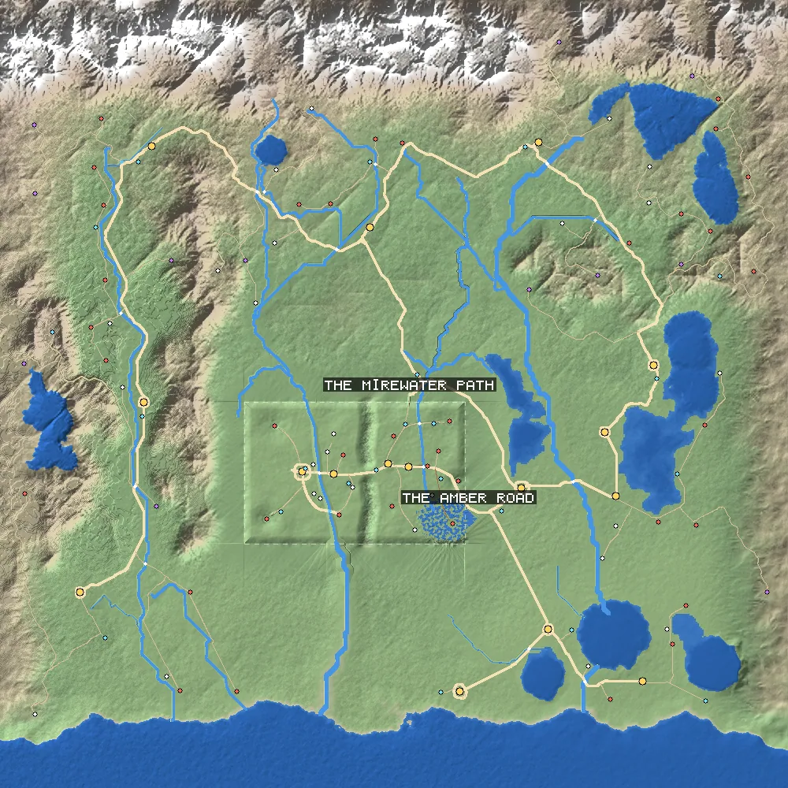
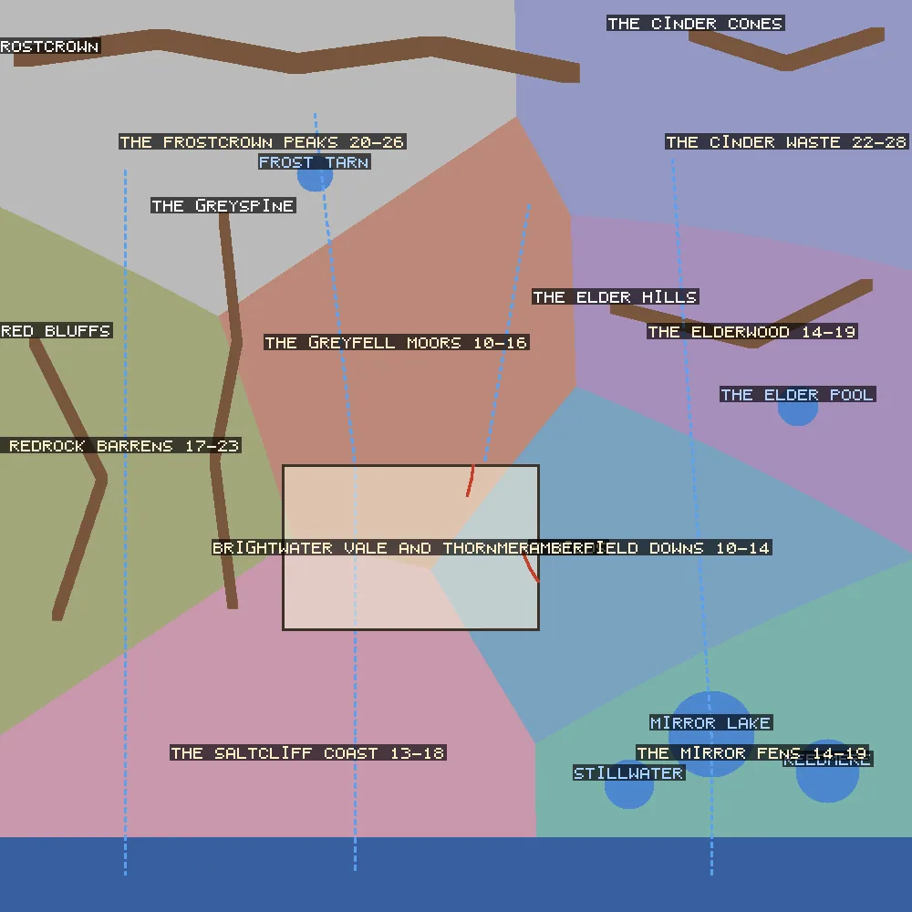
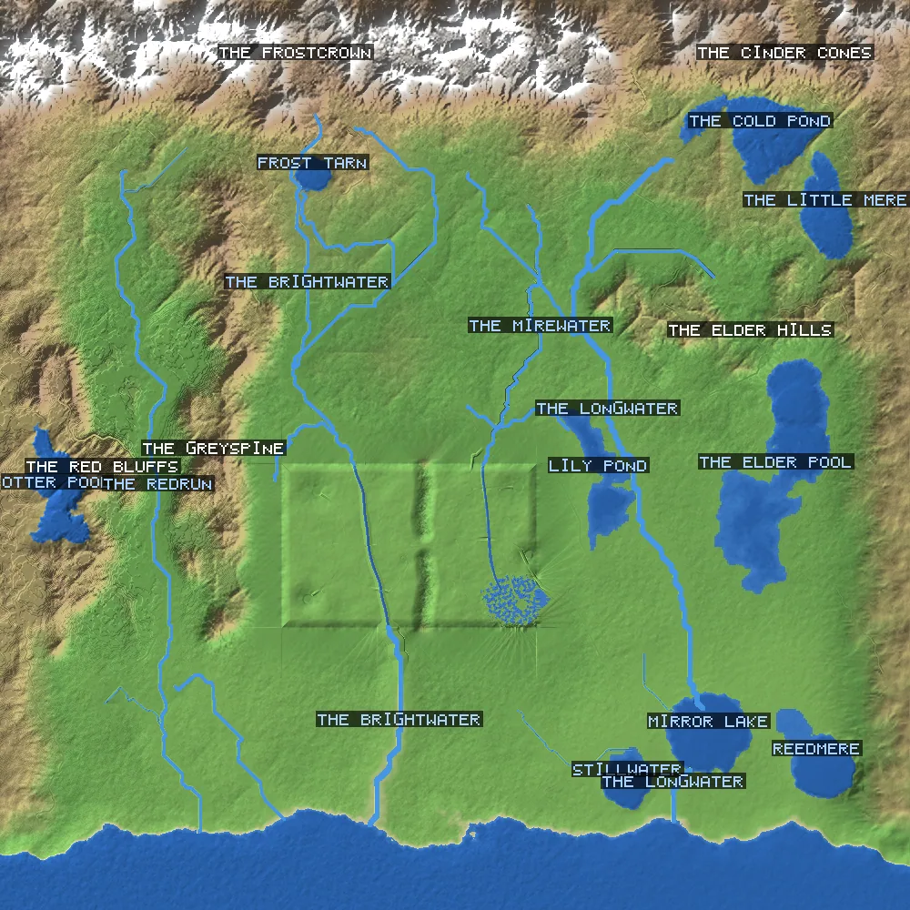
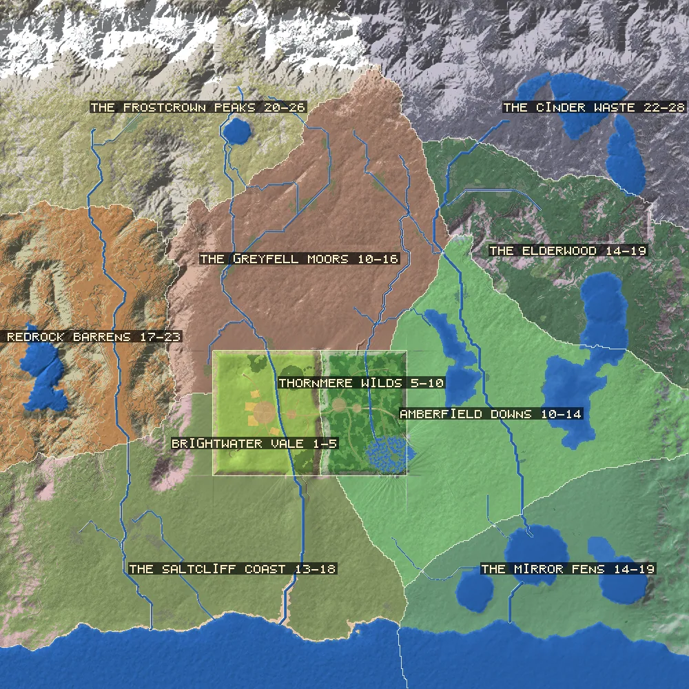
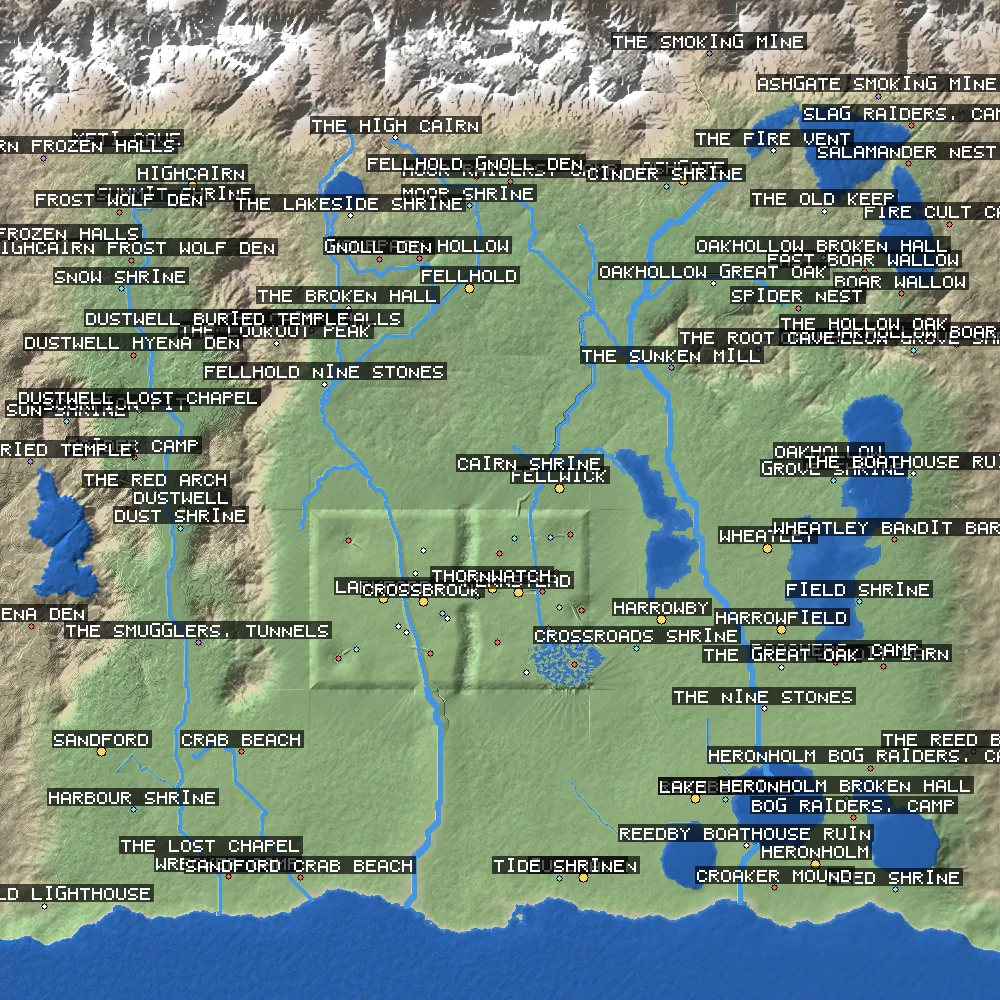
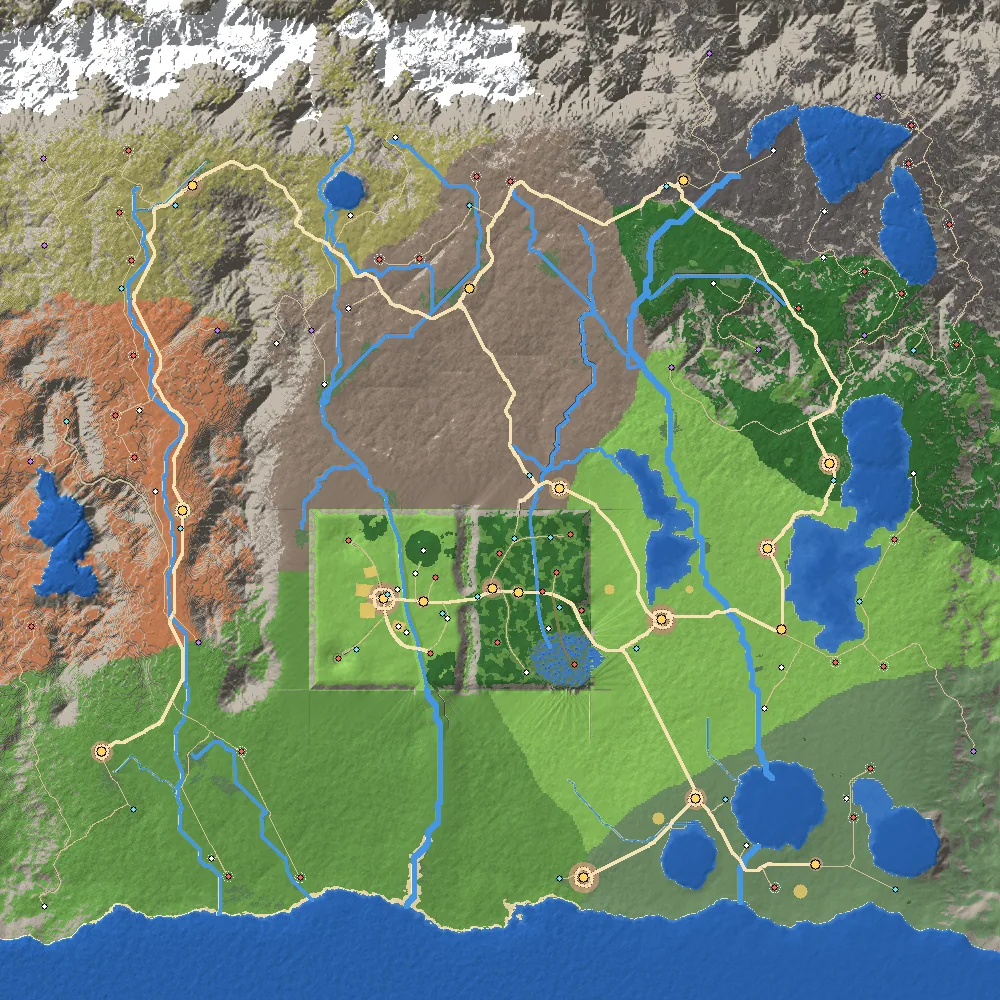
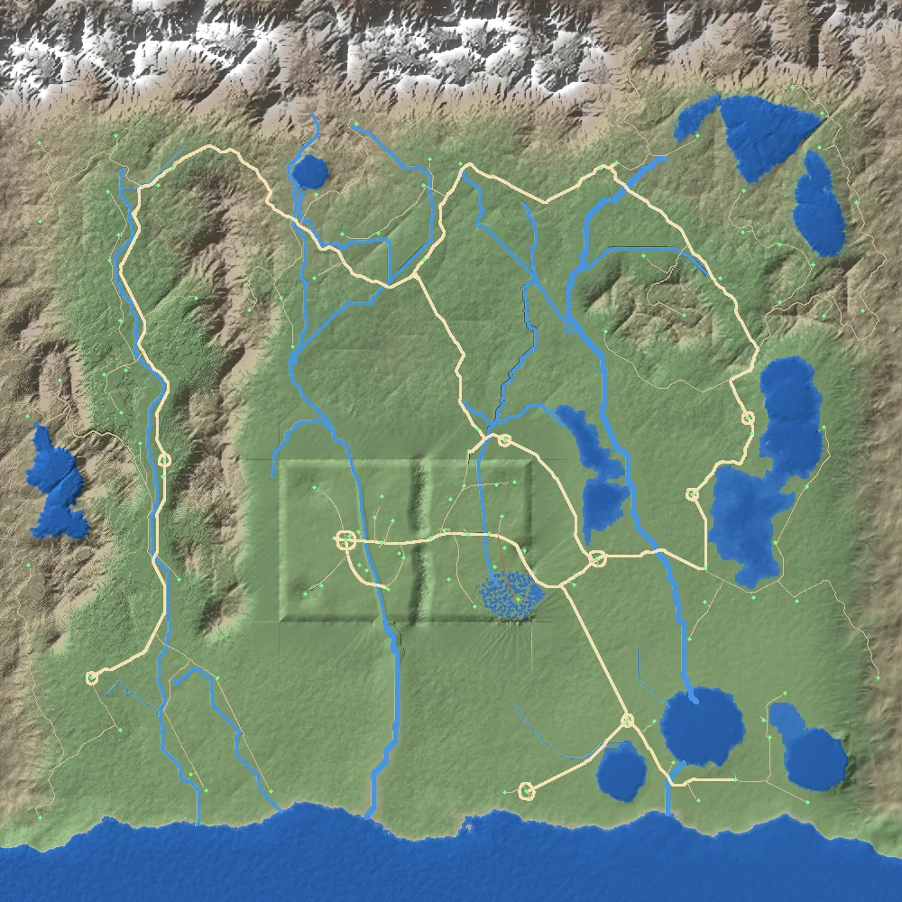

# World Build (`worldbuild/`)

**Status:** built 2026-11-26 (Oathwild world-tools round, item 3). Pipeline, checks, workflow page, streamed 3D fly view,
Node build tool and tests done; the 4 × 4 km sample passes every check. Oathwild's live map is untouched.
**Play:** `http://<LAN-IP>:8401/worldbuild/` (dev) — pick a brief, Build, click any spot, "Fly here in 3D".
Node: `node worldbuild/tools/build.mjs worldbuild/data/briefs/oathwild-4k.json [--seed N] [--out dir]`.
**Next:** owner looks at the 4 km sample (pictures below, fly view) and says what to change in the brief; then Oathwild
adopts the baked map + streamer (section "Adopting it in Oathwild") when he wants the big map in the game.
**Parked:** caves/interiors for dungeons; boats and sea lanes; per-region weather; generated roads are not yet
editable in the map editor (they are brief-driven); a cheaper per-tile tree source for files-only clients (see Limits).

The owner's request (2026-11-26): *"I will eventually want a much larger map. I think we should improve our generative
systems first and build a workflow that makes a detailed world."* Answers: leave the game's map as it is for now, plan on
4 × 4 km, keep Brightwater Vale + Thornmere Wilds (the hand-made 1.2 × 0.8 km map) and grow the world around them.
Brainstorm: `prototypes/oathwild/docs/BRAINSTORM-2026-11-26-world.md` section 3.



## What it does

A **brief** (a JSON file in plain terms) goes through eight stages. Every stage is pure and seeded, has its own picture,
and is timed. Same brief + same seed = the same world, byte for byte (in one process, across processes, with or without
hand edits — `tests/pipeline.test.mjs`).

| # | Stage | What happens | Code |
|---|---|---|---|
| 1 | **Brief** | Read, fill defaults, check (a brief that cannot work says which line is wrong), load the pinned map's files. | `js/brief.js`, `js/pin.js` |
| 2 | **Shape** | An 8 m grid for drainage: region relief blended from their middles, ridged mountain ranges with passes, the world's own edge hills, light weathering (slumping + rain droplets), lake basins, the sea. The pinned map's heights are pasted in from Oathwild's own `createTerrain` and a 260 m seam blends out from its (softened) edge. Rivers the brief names are routed downhill and their valleys cut so they fall all the way (into a lake, the sea, or a pinned river at its edge); pits are filled (priority flood), lakes found, rain gathered, streams traced. Then the 2 m grid the game walks: a smooth upsample + fine detail, the pinned vertices value for value, and every channel cut with terrain.js's own channel shape. | `js/shape.js`, `js/water.js` |
| 3 | **Regions & biomes** | Regions grow from their middles at once; crossing a ridge or a river costs a lot, so borders settle on ridges and rivers. A walk from the start (out of the pinned map only through its gates) gives each spot its share of its region; levels run from the band's low end where you come in to its high end; where two new regions meet, levels climb at most 1 per 70 m. Wetness and woods per spot; biome rules (water, shore/beach, rock, snow above a theme's snow line, scree, marsh/fen, forest, the theme's ground). | `js/regions.js`, `js/themes.js` |
| 4 | **Places** | Towns, shrines, camps, dungeons, landmarks by rule on every 24 m spot a path can reach: towns flat for their size and 40-180 m from fresh water (or near the sea for a harbour), the first near the way in, 330 m apart; shrines near the way in and in the far half; camps and dungeons in the far part (dungeons cut into a slope); landmarks by kind (a broad summit, the thick of a wood, open moor, a named lake's shore, a sea cliff…). If no spot passes, the rules ease twice; a wish that still finds none is listed (the "brief" check). Ground under each is levelled the terrain.js way. | `js/places.js` |
| 5 | **Roads** | Main roads join the towns and the pinned map's gates (spanning tree + loops), town ring lanes and lanes, then a path from every other place to the nearest road. Routing: cheapest path on the 8 m grid with 16 directions; steep steps cost a lot; a step may turn at most 46° from the one before, so a hill is climbed by long slants and switchbacks whose legs stay apart; lakes and sea are walls, every river cell costs. A route that runs along an old road is cut there and its ends snapped ONTO that road (lessons rule 65). Every road line × river line meeting becomes a bridge or a ford, spanning the whole wet stretch (rule 24), the road straight across the deck. Grading and pressing into the ground are terrain.js step 5. | `js/roads.js` |
| 6 | **Detail** | Fields round farming towns; the towns themselves with **Oathwild's own town planner** (`js/world/town.js`: streets first, houses lining them, yards, lamps, villagers); set pieces at camps (tents, fire, palisade), dungeons (a door arch facing downhill), shrines and landmarks; trees and decor per 256 m tile (never stored: same seed = same trees). Trees are Oathwild's BIG storybook species (median 22.6 m, giants up to 50 m; rule 74); inside the pinned map the trees ARE Oathwild's `scatter()`. | `js/detail.js` |
| 7 | **Checks** | Twelve rules with a readable report (below). | `js/checks.js` |
| 8 | **Hand fixes** | The map editor's edit layer survives a re-run (section "Hand fixes"). | `js/edits.js` |

Then `js/terrain-api.js` turns the world into a terrain object with **the same queries as Oathwild's `createTerrain`**
(`heightAt` with the same GRID SPLIT, `walkHeightAt`, `waterAt`, `deckAt`, `walkable`, `swimmable`, `biomeAt`,
`forestAt`, `fieldAt`, `regionAt`, `areaAt`, `levelBandAt`, `roadAt`, roads/rivers/bridges/places…), read from baked
grids. Inside the pinned map it answers exactly what Oathwild answers (`tests/pinned.test.mjs`: 3000 random spots).

## The checks (stage 7)

| Rule | What fails it |
|---|---|
| reach | a place you cannot walk to from the start (a 2 m walk with Oathwild's step rules along the roads and round the places, plus Oathwild's own 4 m flood for the walkable area) |
| brief | a place the brief asked for that found no spot |
| bridges | a road line meeting a river line with no bridge/ford there; a road point in deep water off a deck (whole line, every 2 m; rules 23-24); a deck lower than its bank by over 25 cm |
| clear | a tree trunk, solid decor, a building's whole footprint, a set-piece part or a field on a road (rule 25) |
| grades | a road or town lane climbing over 14% (paths to camps, dungeons and landmarks: 20%); a place on ground you cannot stand on |
| levels | a band jump of more than 6 along any road; levels that fall as you walk further in (per region) or do not follow the walk overall |
| pinned | any pinned ground or water point changed outside the gate roads (fingerprints compared) |
| rivers | a river surface that rises; water floating over its bed; a river ending on dry land |
| links | a road end that meets neither a place nor another road; a road not joined to the network the start is on (rule 65) |
| trees | median grown tree under 18 m (rule 74) |
| towns | a town with no houses |

Every rule is tested to FAIL when broken (lessons rule 32): `tests/pipeline.test.mjs` "checks fail when broken".

## The 4 × 4 km sample (`data/briefs/oathwild-4k.json`, seed 4242)

Oathwild's hand-made map pinned **with its coordinates unchanged** (`pin.at [0, 0]`: every camp, chest, NPC and quest
position in Oathwild's data still means the same spot) in a world spanning x −1800…2200, z −2400…1600. Eight new
regions round it, all level 10+:

| Region | Theme | Levels | Where |
|---|---|---|---|
| Amberfield Downs | farmland | 10-14 | east, through the Amber Road gate (Ogre Hill 8-9 → 10) |
| the Greyfell Moors | moor | 10-16 | north, through the Mirewater Path gate (Druid Circle 6-7 → 10) |
| the Elderwood | old deep forest | 14-19 | north-east |
| the Mirror Fens | lakes and fens | 14-19 | south-east |
| the Saltcliff Coast | sea cliffs and coves | 13-18 | south-west, on the sea |
| the Redrock Barrens | red rock | 17-23 | west |
| the Frostcrown Peaks | snow peaks | 20-26 | far north (a high valley under the range) |
| the Cinder Waste | ash and fire vents | 22-28 | far north-east |

Rivers join at the pinned map's edges: the Brightwater comes in from the north and runs out south to the sea, the
Mirewater comes in from the north. Roads leave from the Wilds side only (two gates); a road out of the Vale (levels
1-5) would lead straight into level 10+ country, so its rivers join but no road does (judgement call — say if you want
the Vale gates back; the brief's `pin.gates` is all it takes).

Result: 17 towns (384 houses), 38 camps, 22 shrines, 12 dungeons, 26 landmarks; 15.3 km of road and 22.2 km of paths
(13.9 + 20.1 km new), 16 bridges + 2 fords, 8 rivers + 11 streams (19.6 km), 9 lakes, 15,684 trees (median 22.6 m, 362
giants), 8 farm fields. **Every check passes**; 0 of 201,448 pinned ground points changed (1,073 re-graded under the 2
gate roads). About 30-40 s in Node or in the page's worker, ~430 MB; files: map.json 193 KB + 289 tiles (36.9 MB).

| | | |
|---|---|---|
|  1 Brief |  2 Shape |  3 Regions & biomes |
|  4 Places |  5 Roads |  6 Detail |
|  7 Checks | | |

Other briefs: `pinned-2k.json` (the hand map + 3 regions in 2.4 × 2 km, ~12 s, what the pinned tests use),
`valley-small.json` (1.6 × 1.2 km, nothing pinned, ~4 s, the phone default and the multi-seed tests).

## The brief

```jsonc
{
  "id": "…", "name": "…", "seed": 4242,
  "size": { "bounds": { "minX", "maxX", "minZ", "maxZ" }, "cell": 2, "margin": 40 },   // metres; x east, z SOUTH
  "relief": { "base": 16, "roll": 22, "detail": 1.4 },
  "sea": { "edges": ["south"], "from": 330, "shelf": 160, "depth": 16, "wobble": 140 },
  "start": { "at": [x, z], "name": "Larkford" },                // moved to the nearest dry spot if it lands in water
  "pin": { "map", "towns", "placements", "edits", "at": [0, 0], "keep": "play", "seam": 260,
           "gates": [{ "id", "name", "road": "<pinned road>", "end": "end", "via": [[x, z]], "edge": [x, z], "class", "width" }],
           "rivers": [{ "river": "brightwater", "end": "in" | "out" }] },
  "ranges": [{ "id", "name", "points": [[x, z]…], "height", "width", "sharpness", "passes": [[x, z, depth]] }],
  "lakes":  [{ "id", "name", "at", "radius", "depth" }],
  "rivers": [{ "id", "name", "from": [x, z] | "pin:<river>" | "lake:<id>", "to": "sea" | "lake:<id>" | "pin:<river>" | [x, z], "width", "depth" }],
  "streams": { "catchment": 0.1, "max": 26, "minLength": 260, "width": [4, 8] },        // km² of rain per stream
  "regions": [{ "id", "name", "theme", "at": [x, z], "levels": [lo, hi], "weight",
                "towns": [{ "name"?, "size": "town|village|hamlet", "by": "sea"? }] | n, "camps": n, "dungeons": n,
                "shrines": n, "landmarks": [{ "kind": "standing_stones|old_tree|peak|ruin|lakeside|lighthouse|arch|vent", "near"? }] | n,
                "fields": n }]
}
```

Themes (`js/themes.js`, one row each): farmland, moor, oldwood, fen, coast, badlands, alpine, ashland — relief, ground,
woodiness, wetness, tree species (Oathwild's storybook ids), decor, house styles and fences for the town planner, name
pieces (plain English place-name parts; no third-party names, none of the banned words), camp and dungeon kinds.

## Output (what the game could load)

`tools/build.mjs` writes `map.json` in **Oathwild's own map schema** (bounds, grid, limits, frame, regions, border,
hills, ridges, rivers, roads, crossings, places, areas, forests, fields, marshes, spawn — the pinned map's rows
unchanged, ids unchanged) plus **opt-in** fields today's terrain.js ignores: `baked` (the ground as 256 m tiles), `lakes`,
`sea`, `setPieces`, `generator`. `towns.json` in Oathwild's towns schema. `tiles/<tx>_<tz>.bin`: `WBT1` header + height
Float32 129² (2 m vertices, edges shared), water Float32 (left out when dry), water kind, biome (4 m), region / level /
forest (8 m) — `js/export.js` `writeTile` / `readTile`. Plus one PNG per stage and `report.json` / `report.txt`.

### Adopting it in Oathwild (not done — the live map stays as it is)

1. Server and browser: `T = map.baked ? bakedTerrain(worldFromTiles(map, tiles)) : createTerrain(map)` — terrain.js
   itself does not change; `worldbuild/js/terrain-api.js` already answers every query the game uses (towns, scatter,
   encounters, quests and the client renderers all read T). The server keeps the heights (it needs them for collisions
   anyway); the client asks for tiles near the player.
2. Client rendering: `worldbuild/js/fly/stream.js` with `ask()` going to the server instead of a worker
   (`chunk`, `tile`, `town`, `bridges` — `js/worker.js` is the reference server side). Trees, towns and bridges are
   drawn with Oathwild's own builders already.
3. Missing for that day: a `worldFromTiles()` loader (the inverse of `export.js`; ~100 lines) and moving scatter to
   per-tile on the server (`detail.js treesInTile` already does it).

## The 3D fly view and streaming (`js/fly/`)

Click a spot on any stage picture → **Fly here in 3D**. Controls: W A S D (W = where the camera looks), Q / E down and
up, drag to look, wheel for speed; touch: drag the left half to fly, the right half to look, Up / Down buttons; gamepad:
sticks + triggers. Detail: Low / Medium / High. The panel shows the streamer's numbers live.

`js/fly/stream.js` (the module Oathwild can adopt):
- **Ground**: a quadtree of chunks, each 128 × 128 cells whatever its size: 256 m at 2 m cells (the exact walked grid),
  512 m at 4 m, 1 km at 8 m … 8 km at 64 m. A chunk splits when the viewer is nearer than 1.6 × its size (Medium);
  it keeps drawing until all four children have arrived, so there are never holes; skirts hide the seams between sizes.
  Water is meshed per chunk from the water grid. Ground is textured from Oathwild's painted ground pictures + snow /
  ash / gravel from the high-detail kit (`ground-mat.js`, one paint map per chunk, rock on steep ground; rule 77).
- **Trees**: per 256 m tile, Oathwild's storybook trees (`fly/trees.js`): the near build within 260 m, the far build of
  the same tree (and only grown trees) to 700 m. Rocks and set pieces near only (textured).
- **Towns** within 650 m (Oathwild's `town-draw.js` / House Kit), **bridges** within 600 m (`bridge-draw.js`).
- **Far backdrop**: a ring of far mountains round the world + the sea plane past a sea edge — two draws.
- **Memory**: chunks not drawn are kept up to a budget (Medium 140 MB of geometry), then the oldest are freed.

### Measured (`tools/stream-bench.mjs`, `docs/stream-bench.json`)

Measured 2026-11-26 on this VM, the 4 km sample (seed 4242), Medium detail. The page built the whole world in its worker
in **29 s** (Node: 29-40 s, 426 MB).

**Cost of one piece** (what a game server pays; `docs/stream-bench-server.json`):

| Piece | Time | Size sent |
|---|---|---|
| ground chunk 256 m (2 m cells, exact) | 1.4 ms avg, 8 ms worst | 136 KB |
| ground chunk 512 m / 1 km | 7 / 4.6 ms | 136 KB |
| ground chunk 2 / 4 / 8 km | 1.6 / 1.1 / 1.1 ms | 136 KB |
| a tile's trees, rocks and set pieces | 1 ms avg, 2-4 ms worst | ~2-10 KB |
| a town's plan + height patch | ≤ 1 ms | |
| reading a tile file (`readTile`) | 0.11 ms avg, 3 ms worst | 125 KB a tile, 289 tiles = 36.9 MB |
| building a chunk's mesh in the page | 5 ms avg, 40 ms worst | |

**What is drawn** at five spots (`docs/stream-bench.json`, headless Chromium):

| Spot | Draw calls | Triangles | Ground chunks drawn (by size) | Chunk cache | Trees drawn | Script heap |
|---|---|---|---|---|---|---|
| Pinned town (Larkford), 35 m up | 118 | 1.68 M | 71 (32 × 256 m, 32 × 512 m, 6 × 1 km, 1 × 4 km) | 60 MB | 2,440 | 164 MB |
| New town (Harrowby), 35 m up | 111 | 1.33 M | 66 | 83 MB | 1,101 | 196 MB |
| Deep woods, 30 m up | 47 | 0.74 M | 66 | 97 MB | 209 | 218 MB |
| Mountains, 60 m up | 14 | 0.41 M | 74 | 126 MB | 0 | 202 MB |
| High over the middle, 700 m up | 116 | 1.42 M | 109 | 138 MB | 3,028 | 260 MB |

The cache grows as you fly (chunks you passed are kept up to the 140 MB budget, then the oldest go). Headless Chromium
draws with a software GPU — a frame takes seconds there — so its wall-clock "time until a chunk shows" (seconds) mostly
measures waiting for frames, and frame rates mean nothing; on a real GPU the chunk wait is the worker's few ms plus one
frame. Things to tune when Oathwild adopts it: Medium splits to 256 m chunks within ~410 m, which is 32 exact chunks
(~1 M triangles) round a town — Low (split 1.25) roughly halves that for phones; trees are 2-4 meshes per tile.

## Hand fixes (stage 8) — the contract with the map editor

The edit layer is **the map editor's own file and rules** (`prototypes/oathwild/data/edits.json`,
`prototypes/oathwild/js/world/edits.js`); World Build only decides when each part applies:

- `ground` strokes (raise / lower / flatten / smooth) hit the raw 2 m ground right after Shape, before rivers, places and
  roads are cut — as in the game, so roads stay graded and bridges meet them. Inside the pinned map Oathwild's
  `createTerrain(map, { ground })` applies them itself.
- `trees` (`remove` by spot id `t<x·10>_<z·10>`, `add`, `areas`) and `decor` apply per tile with the editor's
  `sceneryWithEdits()` — the same brush grows the same trees. A generated tree's id is where it stands, so the same seed
  gives the same ids and a removal keeps meaning that tree after a re-run.
- `moves`: `places:<id>` moves a generated place (before roads, so its path follows); other groups (`camps:`, `npcs:` …)
  belong to the pinned map's placements and are the game's.
- `zones`, `looks`, `notes` are the game's own (carried, not applied here).
- A fix whose target is gone after a re-run (a removed tree no longer grown, an unknown place, a stroke off the map) is
  listed in the report as **left over** — never dropped silently — and stays in the file.
- Roads, rivers and bridges of the pinned map are hand data in its `map.json` (the editor edits them there); generated
  roads and rivers change through the brief.

The 4 km and 2 km briefs read the game's own layer (`pin.edits`); `build.mjs --edits file` uses another one.

## Judgement calls (the owner may overrule)

- The pinned map keeps its own coordinates; the 4 km world is placed round it (x −1800…2200, z −2400…1600).
- "Unchanged" = the map's play area (its bounds minus the 40 m out-of-bounds margin); its mountain frame outside that
  becomes the seam. Gate roads are the only change inside (1,073 ground points, all under the two roads).
- Roads leave only from the Wilds (see above). Paths to camps, dungeons and landmarks may climb 20% (roads 14%).
- Bridge decks meet the LOWER bank; the road leaves the deck in a short cutting where the far bank is higher.
- New regions' levels ease up by at most 1 per 70 m where they meet, so a region's edge can sit under its band.
- Where a river crosses a hollow to reach a lake or a bigger river, its bed and banks are built up (a levee).

## Limits

- The page builds the world in its worker each time (≈ 30 s for 4 km on this VM; the phone default is the small
  brief). The fly view asks the worker for pieces; a files-only client would need `worldFromTiles()` (above).
- Trees in a tile need the whole world model (roads, places, town plans) — fine on a server, heavy for a phone alone.
- Region borders follow ridges and rivers on an 8 m grid, so they are a little stepped.

## Files

`js/core.js` helpers · `js/brief.js` · `js/pin.js` · `js/shape.js` + `js/water.js` · `js/regions.js` · `js/places.js` ·
`js/roads.js` · `js/terrain-api.js` · `js/detail.js` · `js/checks.js` · `js/edits.js` · `js/pipeline.js` ·
`js/preview.js` (pictures, pure; a 5×7 pixel font for Node PNGs) · `js/export.js` · `js/themes.js` · `js/worker.js` ·
`js/app.js` + `index.html` + `worldbuild.css` (the page) · `js/fly/` (stream, ground-mat, trees, fly) ·
`tools/build.mjs` · `tools/stream-bench.mjs` · `tests/pipeline.test.mjs` + `tests/pinned.test.mjs` (+ the page check
`tests/worldbuild.spec.js`) · `data/briefs/` · `docs/` (pictures, bench numbers). `out/` is not committed.

Reuses: World Forge's noise (`worldgen/js/noise.js`); Oathwild's terrain (pinned piece, lines, reach flood), town
planner, scatter + storybook trees + tufts, town and bridge drawing, ground pictures, edit layer; the high-detail kit's
surfaces and rocks.
